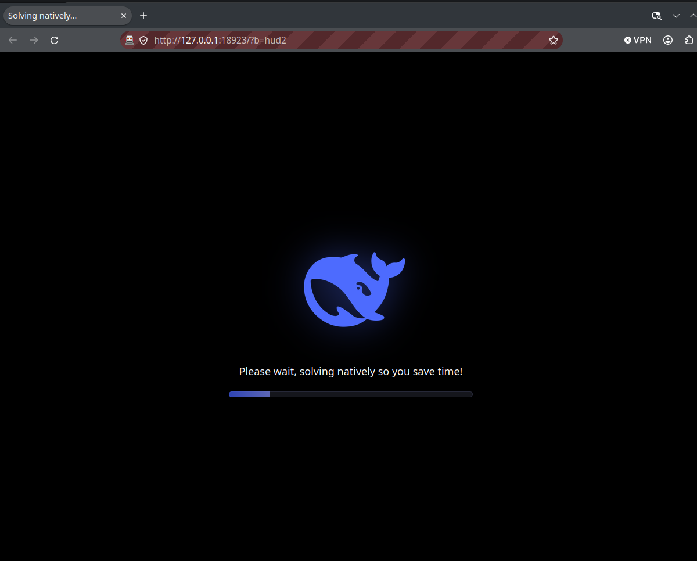

# Anubis Native Solver — Firefox Extension

**A Firefox WebExtension that solves [Anubis](https://github.com/TecharoHQ/anubis) anti-bot proof-of-work challenges with native C code over native messaging — no browser JS/WASM solver, no waiting on `Calculating…`.**

`Anubis solver` · `Anubis bypass` · `Firefox extension` · `native messaging` · `proof of work` · `anti-bot` · `git.ffmpeg.org`

Anubis normally makes your browser hash the challenge in JavaScript/WebAssembly.
This add-on **blocks that solver**, shows a black whale loading screen, passes
the challenge JSON to a small statically-linked C host, and navigates straight
to the `pass-challenge` URL. On `git.ffmpeg.org` (`fast` difficulty 6) the
native solve is **~0.30 s**; the page's own solver took **~31 s** in our
benchmark.



---

## Features

- **Native C solver** via Firefox native messaging (`runtime.sendNativeMessage`).
- **Blocks Anubis' JS/WASM solver before it loads** — `webRequest` cancels
  `main.mjs` and the worker scripts, so the page's 8 workers never start.
- **Hijacks the challenge document** (`webRequest.filterResponseData`): the tab
  receives a tiny HTML page containing only the challenge JSON, so Anubis' CSS,
  `main.mjs`, worker/WASM and mascots are never loaded or rendered.
- **Hashes the challenge JS once per host** (SHA-256) and caches the host→hash
  map in `browser.storage.local`, so later visits are blocked immediately.
- **Black whale screen** with an animated progress bar and
  “Please wait, solving natively so you save time!” — the page never shows
  `Calculating…`.
- **8-thread nonce search** with SHA-256 midstate precomputation.
- Handles every Anubis challenge type in the open-source server:
  `fast` / `slow`, `sha256`, `argon2id`, `hashx`, plus `metarefresh` and the
  `css-load` extension.
- **Automatic fallback**: if the host is missing, fails, or cannot do
  `argon2id`, the page reloads and Anubis' normal JS/WASM solver runs. You never
  get stuck.
- **Page-world navigation** so `Partitioned` (CHIPS) verification cookies are
  sent correctly on the `pass-challenge` request.
- Works with regular Firefox and **snap Firefox** (static host for core24).
- Keeps the browser's own cookies/session; no proxy, no TLS interception.

## Benchmarks

Two sets of measurements:

1. **Real world** — live `https://git.ffmpeg.org/ffmpeg.git` (Anubis v1.28.1, `fast` difficulty 6).
2. **Every Anubis tier** — a local Anubis v1.28.1 instance (same version as the `anubis/` checkout) using the default policy tiers and the algorithm-equivalent difficulties from the Anubis docs.

Three columns in both tables:

- **Native C (no browser)** — the C host/harness solves and passes directly; no Firefox.
- **Standard Firefox** — Firefox 157 headless with no extension; Anubis' own JS/WASM solver runs.
- **Firefox + module** — the same Firefox with this extension + native messaging.

### Real world: `git.ffmpeg.org/ffmpeg.git` (`fast` d6)

| Mode | End-to-end from process launch | Solver |
|---|---:|---:|
| Native C (no browser) | **1.00 s** | **0.30 s** |
| Standard Firefox | 30.84 s | page JS/WASM |
| Firefox + module | **7.41 s** (includes ~6 s web-ext startup) | **0.14 s** |

The module's end-to-end number is inflated by launching a fresh Firefox +
`web-ext` for every test. In an already-open Firefox the extension's own cost is
the host solve (**~0.1–0.9 s**) plus the challenge page load.

### 20 refreshes on `git.ffmpeg.org`

| Mode | Challenged | Median total | Median solve |
|---|---:|---:|---:|
| Cold — fresh cookie jar each refresh | 20/20 | **1054.9 ms** | 320.2 ms |
| Warm — same cookie jar, Anubis auth cookie | 1/20 | **298.8 ms** | 319.0 ms (first) |

The first successful pass sets Anubis' auth cookie; the next 19 refreshes are
served directly. That is a **~72% median drop** (1.05 s → 0.30 s). 19/20 cold
refreshes passed; one was a transient outlier. The native solver itself stayed
at ~0.32 s median — the drop is the cookie/cache, not a faster hash.

These are HTTP-level timings from the native client (no browser rendering);
Firefox adds normal page-load time on top.

### Document hijack (v1.0.3)

Verified on live `git.ffmpeg.org`:

- **0** requests for Anubis' xess CSS.
- **0** requests for `static/js/main.mjs`.
- Native `fast` d6 solve: **200.5 ms**.
- Auth cookie set; final gitweb page reached.

Locally, `fast` d4 module latency went from ~921 ms to **~875 ms** — the browser
page/process floor dominates, so the hijack is not a dramatic latency win. Its
value is that Anubis' CSS/JS/WASM/UI never load (less CPU/network, no
`Calculating…`). One local sample fell back to the original document while the
native host still solved; the fallback is intentional.

### Default policy tiers (local Anubis v1.28.1)

| Tier | Challenge | Native C (no browser) | Standard Firefox | Firefox + module |
|---|---|---:|---:|---:|
| T0 minimal | ALLOW | no challenge | no challenge | no challenge |
| T1 mild | `metarefresh` d1 | 1.11 s | 2.31 s | 2.19 s |
| T2 moderate | `fast` d2 | **7.6 ms** | 814 ms | 857 ms |
| T3 elevated | `fast` d4 | **8.0 ms** | 2.55 s | 921 ms |
| T4 extreme | `fast` d6 | **76 ms** | 13.58 s | 2.05 s |

### Algorithm-equivalent tiers

| Algorithm | Difficulty | Native C (no browser) | Standard Firefox | Firefox + module |
|---|---:|---:|---:|---:|
| `fast` | 2 | 7.6 ms | 814 ms | 857 ms |
| `fast` | 4 | 8.0 ms | 2.55 s | 921 ms |
| `fast` | 6 | 76 ms | 13.58 s | 2.05 s |
| `sha256` | 8 | 6.6 ms | 876 ms | 782 ms |
| `sha256` | 16 | 8.8 ms | 834 ms | 822 ms |
| `sha256` | 24 | 360 ms | 2.58 s | 3.41 s |
| `argon2id` | 2 | 401 ms | 1.14 s | 2.00 s |
| `argon2id` | 4 | 473 ms | 1.16 s | 1.49 s |
| `argon2id` | 6 | 500 ms | 2.06 s | 1.30 s |
| `hashx` | 7 | 11.7 ms | 860 ms | 835 ms |
| `hashx` | 15 | 15.5 ms | 966 ms | 833 ms |
| `hashx` | 20 | 445 ms | 1.30 s | 1.21 s |

**How these were measured**

- Local: Anubis v1.28.1 (same version as the `anubis/` checkout), local HTTP, i7-1260P (16 threads), 8 solver threads, 16 GB RAM.
- Challenge latency = server `new challenge issued` → `challenge accepted`. Native cells are medians of 3 runs; module cells 1; standard Firefox cells 1. Browser cells include challenge page load and JS/WASM startup.
- The module's low-tier times are dominated by the ~0.8 s challenge page/extension load. Its advantage grows with the challenge cost.
- At `fast` d6, `argon2id` d6, and on the real-world site the native path wins clearly. For cheap `sha256`/`hashx` tiers the page's WASM solver is competitive, and a single module sample can be slower than Firefox (`sha256` 24, `argon2id` 2) due to page-load and CPU variance.
- Variance is nonce- and CPU-load-dependent; browser cells are intentionally 1 run (high tiers take seconds to minutes).

**Compiler flags:** the native host is built with `-O3`. The measured gain over
`-O2` is small (~3–6% on the `fast` SHA-256 loop, neutral on `hashx`/`argon2id`);
the hot path is OpenSSL's SHA-NI assembly plus the 8-thread/midstate design, not
the C optimizer. `-march=native`/LTO did not help consistently on Alder Lake.

Solve time is dominated by the random winning nonce, so expect variance. The
host logs every solve to `~/anubis-native.log`:

```
2026-10-17 14:24:17 url=https://git.ffmpeg.org/ffmpeg.git?demo=2 algo=fast diff=6 solve_ms=555.6 ok=1
```

## How it works

```
background.js (webRequest)
  ├─ onHeadersReceived spots Anubis (verification cookie / .within.website)
  ├─ onBeforeSendHeaders forces Accept-Encoding: identity for Anubis docs
  ├─ onHeadersReceived buffers the challenge HTML, extracts
  │    #anubis_version + #anubis_base_prefix + #anubis_challenge,
  │    and writes a tiny HUD page instead  ← no Anubis CSS/JS/WASM
  ├─ cancels .../cmd/anubis/static/js/main.mjs + worker scripts
  │    ← the page's JS/WASM solver never starts
  ├─ fetches the challenge JS once and stores SHA-256(host)
  └─ remembers the host in browser.storage.local

content.js (document_start)
  ├─ black overlay: whale + animated progress bar + "Please wait..."
  ├─ sets window.__anubisBooted = true          ← second line of defence
  ├─ reads #anubis_challenge + #anubis_base_prefix
  └─ background.js ──sendNativeMessage──► anubis_native (static C host)
                                             ├─ 8-thread PoW
                                             ├─ midstate SHA-256
                                             ├─ css-load probe URL
                                             └─ metarefresh delay
       ◄─ { passUrl, cssUrl, delayMs }
  └─ page-world location.replace(passUrl)       ← browser keeps its cookies

fallback: filter parse fails → original body; native fails → force-allow tab
           → reload → Anubis' page solver
```

The host is a normal native-messaging app: a 4-byte little-endian length
followed by UTF-8 JSON on stdin/stdout.

## Supported challenges

| Algorithm | Native host |
|---|---|
| `fast` / `slow` | ✅ midstate + 8 threads |
| `sha256` | ✅ midstate + 8 threads |
| `hashx` | ✅ 8 threads |
| `argon2id` | ✅ if the static OpenSSL build has the Argon2 provider, otherwise fallback |
| `metarefresh` | ✅ timed pass URL |
| `css-load` extension | ✅ probe fetched before the pass |

Threads: `FB_ANUBIS_THREADS` (default **8**, max 64).

## Install

Requirements (build machine):

```bash
sudo apt install build-essential libssl-dev zlib1g-dev libzstd-dev
```

Then:

```bash
git clone https://github.com/celikfana-lab/anti-Anubis.git
cd anti-Anubis
./install.sh
```

`install.sh` builds a statically linked host and installs:

| what | where |
|---|---|
| host binary | `~/snap/firefox/common/anubis-native/anubis_native` |
| host manifest (regular Firefox) | `~/.mozilla/native-messaging-hosts/anubis_native.json` |
| host manifest (snap Firefox) | `~/snap/firefox/common/.mozilla/native-messaging-hosts/anubis_native.json` |

### Load the extension

Temporary (until Firefox restarts):

1. Open `about:debugging#/runtime/this-firefox`.
2. **Load Temporary Add-on…**
3. Select `manifest.json` from this repository.

Permanent: sign the add-on (unlisted AMO) or use Firefox Developer
Edition/Nightly with `xpinstall.signatures.required=false`.

### Private windows

Firefox does not run extensions in private windows by default. Go to
`about:addons` → **Anubis Native Solver** → **Details** → enable
**Run in Private Windows**.

### Snap Firefox

The host is built **statically** because snap Firefox (core24) cannot see your
system glibc/OpenSSL. `install.sh` copies it into the snap's home and writes the
snap native-messaging manifest for you.

## Build only

```bash
make -C native          # -> native/anubis_native
make -C native dynamic  # dynamic build for debugging
```

## Troubleshooting

- **Still sees `Calculating…` / the page solver runs**: make sure the add-on is
  listed in `about:debugging`, not in a private window, and check the Browser
  Console (`Ctrl+Shift+J`) for `[anubis-native]` errors.
- **`No such native application anubis_native`**: re-run `./install.sh` and
  restart Firefox. Verify the manifest contains the right `path` and
  `allowed_extensions: ["anubis-native@flixbrute.local"]`.
- **`Error: An unexpected error occurred` from the host**: inspect the Browser
  Console; the host writes diagnostics to stderr (Firefox forwards it to the
  console).
- **No `~/anubis-native.log`**: the host never ran (add-on inactive or the
  page was served from cache with a valid auth cookie). Append `?x=random` to
  the URL or clear the site's cookies.

## Security & privacy

- The native host is local; it reads framed JSON on stdin and writes JSON on
  stdout. Nothing is uploaded.
- `webRequest` cancels only Anubis' `/.within.website/x/cmd/anubis/static/js/*`
  paths. It does not block other JavaScript.
- The challenge JS is downloaded **once by the extension** to compute a local
  SHA-256; the host→hash map lives in `browser.storage.local`. Nothing is sent
  anywhere.
- The document hijack (`filterResponseData`) buffers the challenge HTML locally,
  extracts the three JSON scripts, and writes a minimal page. It preserves
  `Set-Cookie`; it only removes `Content-Length`, `Content-Encoding`, and CSP
  from the substituted document.
- The extension asks for `<all_urls>` so it can detect challenges on any site
  and fetch the `css-load` probe with the page's cookies. It does not contact
  any remote service.
- Permissions: `nativeMessaging`, `storage`, `webRequest`, `webRequestBlocking`,
  `<all_urls>`.
- The host runs as your user and is launched by Firefox; no setuid, no daemon,
  no open port.
- Respect the terms of service of sites you visit and use this on systems you
  are authorized to access.

## Keywords / search terms

Anubis solver, Anubis bypass, Anubis proof-of-work solver, Anubis anti-bot,
Techaro Anubis, Firefox Anubis extension, native messaging Anubis,
Anubis difficulty 6, git.ffmpeg.org Anubis, Firefox native solver,
anti-bot challenge solver, Anubis JS/WASM replacement, Anubis hashx,
Anubis argon2id, Anubis sha256, CHIPS partitioned cookies, WebExtension
native messaging.

## Credits & license

- [Anubis](https://github.com/TecharoHQ/anubis) by Techaro (MIT) — challenge
  formats and algorithms.
- [HashX](https://github.com/tevador/hashx) by tevador / The Tor Project —
  `native/solver/hashx.c` is a C port and remains **LGPL-3.0** (see
  `LICENSES/LGPL-3.0.txt`).
- The native solver is derived from the `flixbrute` project by the same author.

Everything else is MIT — see [LICENSE](LICENSE). The bundled `hashx` source is
LGPL-3.0; the rest of the project is MIT.
